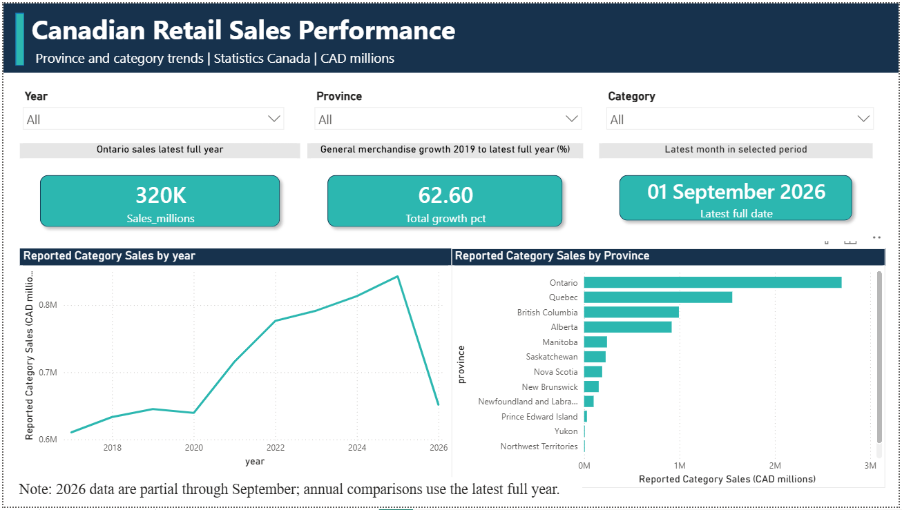
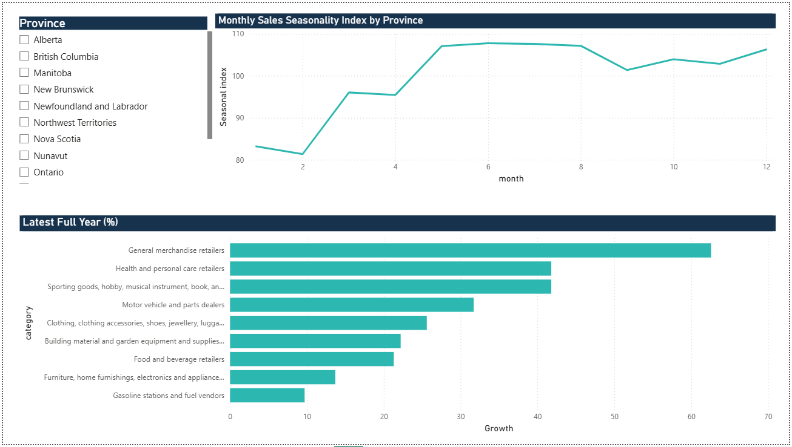
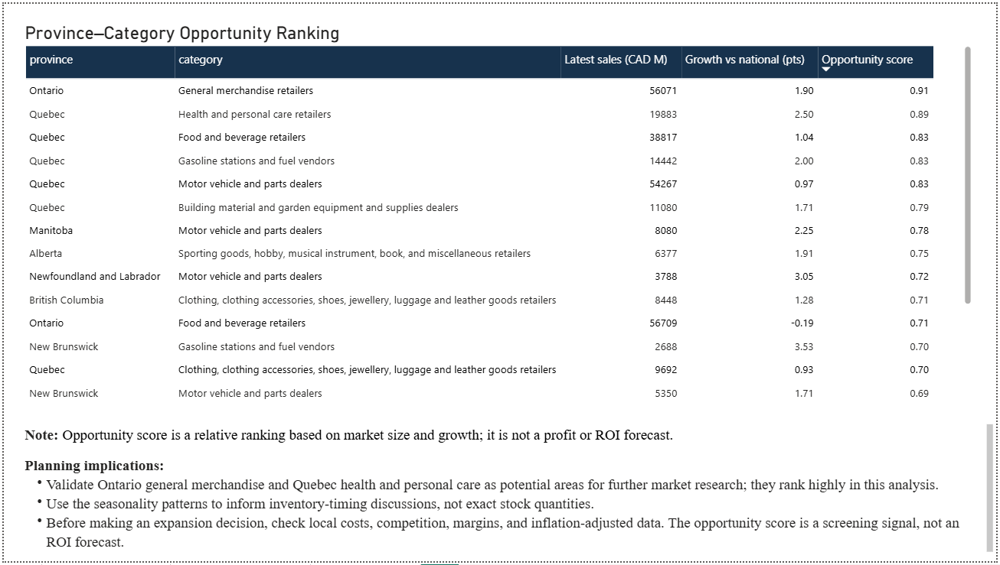
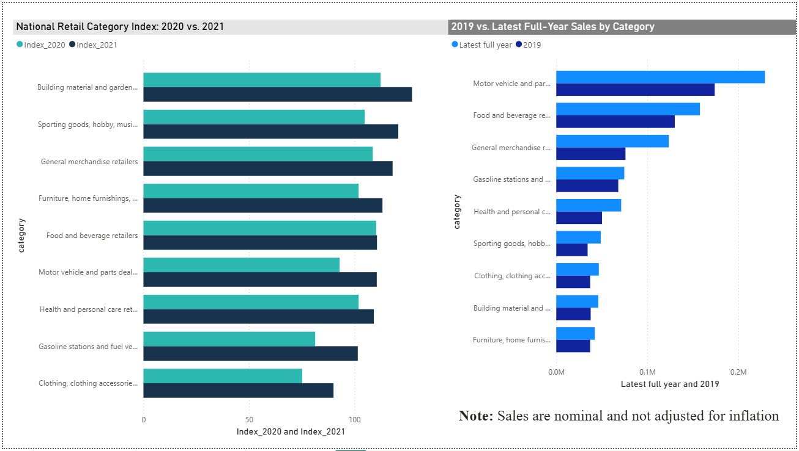

# Canadian Retail Sales Analysis

A retail analytics portfolio project using monthly Canadian retail trade data from Statistics Canada. I built on an existing data pipeline and star-schema project, adding a four-page Power BI report, a separate set of SQL queries and a helper script, to explore provincial retail sales, category growth, seasonality and province–category opportunity indicators.

## Business question

Where could a national retailer focus further market research and planning for 2027, based on reported retail sales, category growth, seasonality and province–category opportunity indicators?

The analysis is descriptive and intended to support discussion. It does not estimate profit, return on investment or the effects of inflation.

## Project transparency

This project is built on a starter project that already contained the data pipeline, database schema and base SQL (see [Starter project and attribution](#starter-project-and-attribution)). Because I could not trace its author or licence, the starter's files are not included in this repository.

My additions are the Power BI report, `sql/portfolio_queries.sql`, `build_portfolio_db.py` and this README. I used AI assistance to draft the SQL in `sql/portfolio_queries.sql`; I then reviewed it and ran the queries against the SQLite database myself.

## Data source

- **Publisher:** Statistics Canada
- **Table:** [Monthly retail trade sales by province and territory, Table 20-10-0056-01](https://www150.statcan.gc.ca/t1/tbl1/en/tv.action?pid=2010005601)
- **Coverage:** Monthly retail sales by province or territory and retail category, plus reported province-level totals.
- **Values used:** Total retail sales, unadjusted (not seasonally adjusted), for provinces and territories at the three-digit NAICS category level, January 2017 to September 2026 (117 months).
- **Source survey:** Retail Trade Survey (Monthly)
- **Citation:** Statistics Canada. Table 20-10-0056-01, Monthly retail trade sales by province and territory (x 1,000). DOI: [https://doi.org/10.25318/2010005601-eng](https://doi.org/10.25318/2010005601-eng)
- **Units:** Statistics Canada publishes this table in dollars (x 1,000). The project data and all figures in this README and the report are in CAD millions.
- **Caveats:**
  - Sales are nominal and not adjusted for inflation.
  - The latest month in the data belongs to an incomplete year (2026 is partial, through September); annual comparisons use complete years.
  - Some province–category observations are unavailable or suppressed, so the category-growth comparison only uses province–category pairs with data in both comparison years.

*Adapted from Statistics Canada, Table 20-10-0056-01, used under the Statistics Canada Open Licence. This does not constitute an endorsement by Statistics Canada of this product.*

## What I added

**Power BI report (four pages)**

| Page | Content |
|---|---|
| Overview | KPI cards, annual sales trend and province sales ranking, with year, province and category slicers |
| Category Analysis | Category growth and monthly seasonality views, with a province slicer |
| 2027 Opportunities | Province–category opportunity ranking with a note on how to read the score |
| COVID Impact | Category sales indices for 2020 and 2021 relative to 2019, alongside a comparison of 2019 and the latest full-year sales |

**SQL**

`sql/portfolio_queries.sql` answers three business questions:

1. Which provinces had the highest reported retail sales in the latest complete year?
2. How did reported province sales change year over year?
3. Which retail categories grew or shrank from the first complete year (2019) to the latest complete year (2025)?

I ran the province-ranking and category-growth queries in DB Browser for SQLite. The category-growth query returned nine categories and compared 2019 with 2025, the latest complete year in the database when I queried it.

**Python helper script**

`build_portfolio_db.py` builds a SQLite database from the project's processed CSV files and checks foreign-key integrity. When I ran it, it loaded 13 provinces, 9 categories, 117 date rows, 11,683 category-sales rows and 1,521 province-total rows, with zero foreign-key violations.

## Dashboard pages

## Selected findings

- **Province ranking:** Ontario ranked first for reported province-level retail sales in 2025, at approximately CAD 319,504 million, or 37.9% of the total across provinces and territories in the query result.
- **Category growth:** From 2019 to 2025, general merchandise retailers had the largest reported growth among the categories in the comparison (62.6%). Gasoline stations and fuel vendors had the smallest positive growth (9.7%).
- **Seasonality:** Using unadjusted province totals averaged across provinces and years (an average month = 100), demand is lowest in February (about 81) and highest from May to August (about 107 to 108).

These are nominal comparisons. They should not be read as inflation-adjusted growth or as evidence of profitability.

## Opportunity score

The opportunity score ranks each available province–category pair using two equally weighted signals: latest complete-year sales (market size) and growth relative to the national rate for that category. The SQL computes the following for each pair:

1. **Province–category CAGR** from the base year to the latest complete year:
   `((latest_sales / base_sales) ^ (1 / (latest_year - base_year))) - 1`
2. **National category CAGR** over the same years, using summed sales for the province–category pairs included in the comparison:
   `((national_latest_sales / national_base_sales) ^ (1 / (latest_year - base_year))) - 1`
3. **Relative growth** is the province–category CAGR minus its category's national CAGR. The reported `growth_vs_national_pts` value is this difference multiplied by 100, so it is expressed in percentage points.
4. **Percentiles:** a market-size percentile and a relative-growth percentile, each calculated with SQL `PERCENT_RANK()` across the included province–category pairs. Each is scaled from 0 to 1, where 0 is the bottom rank and 1 is the top rank (ties receive the same rank).
5. **Opportunity score** is the simple average of the two percentiles:
   `opportunity_score = 0.5 × market_size_percentile + 0.5 × relative_growth_percentile`

The score ranges from 0 to 1. A higher score means the pair ranks relatively well on both market size and growth versus its category's national rate. The SQL rounds the score to three decimal places. It is a relative screening measure, not a profit, ROI or forecast measure.

## Data model

The SQLite database uses a star schema:

- `dim_date`: month, quarter and year attributes
- `dim_province`: province or territory and region attributes
- `dim_category`: retail category attributes
- `fact_retail_sales`: category-level monthly sales
- `fact_province_total`: reported province-level monthly totals

The category-level table and the reported province-total table serve different purposes. Category sales may not reconcile exactly with the province totals published by Statistics Canada because of data availability and suppression.

## Reproducing the analysis

This repository contains only my own additions. The starter project's data pipeline, schema and SQL are not included, so the analysis cannot be re-run from this repository alone.

My workflow was:

1. I used the processed CSV files from the starter project's data pipeline.
2. I built a SQLite database from them with `build_portfolio_db.py`.
3. I ran the queries in `sql/portfolio_queries.sql` in DB Browser for SQLite.
4. I built the Power BI report in Power BI Desktop.

The tables the queries use are described under [Data model](#data-model). The source data is public and can be downloaded from the Statistics Canada table linked above.

## Starter project and attribution

This repository is built on a starter project (listed below) that I used as a foundation. I was unable to trace its original author or licence, so I do not claim these files as my own work.

The following files were present in the starter project and are not my work. They are not included in this repository:

- `sql/schema.sql`
- `sql/views.sql`
- `sql/checks.sql`
- `sql/mysql_load.sql`
- `sql/analysis_queries.sql`
- The existing data-ingestion and processing pipeline

## Tools

Power BI Desktop, SQLite, DB Browser for SQLite, Python 3.12, SQL

## Limitations

- Reported sales are nominal and not adjusted for inflation.
- Annual analysis is limited to complete years.
- The data are aggregated monthly sales, not individual transactions, so customer or basket analysis is not possible.
- Category growth compares only province–category pairs available in both selected years, so the number of provinces included varies by category.
- The market-size percentile in the opportunity score ranks all province–category pairs together, so larger provinces tend to score higher on size.
- The opportunity score is a relative screening indicator, not a forecast.
- This is an analytical portfolio project, not an official Statistics Canada product.
